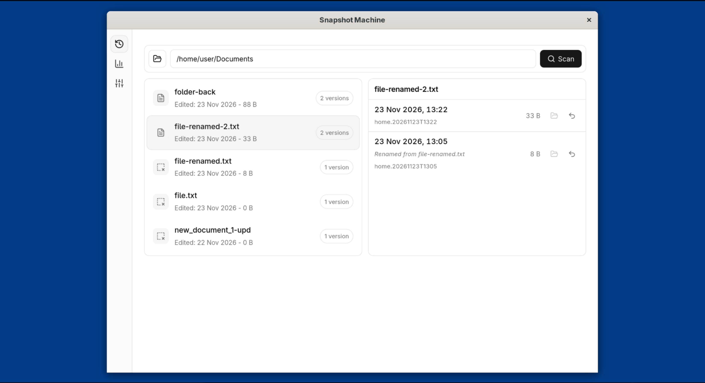

# Snapshot Machine

**Under development**

A user-friendly desktop application for browsing Btrfs snapshot history and
restoring files on Linux. It uses `btrbk` to manage backups.



## Install

Make sure your system use `btrfs` filesystem
[learn more](https://en.wikipedia.org/wiki/Btrfs)

Download the latest version from
[releases](https://github.com/skorphil/snapshot-machine/releases)

### Fedora

```shell
sudo dnf install path/to/snapshot-machine.rpm
```

## Uninstall

By default, config files are preserved after uninstalling the app. If you want
to remove them:

```shell
sudo rm -rf /etc/btrbk/gui.conf.d
```

## Contribute

For contribution see [CONTRIBUTING.md](CONTRIBUTING.md)
